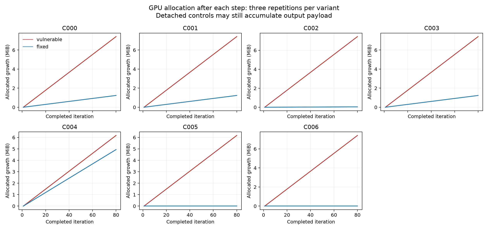

# PyTorch autograd retention study

Partial Phase 2–4 evaluation under the professor's September 2026 methodology: the exploratory pilot, five public-source benchmark pairs, repeated runtime evidence, four-tool baseline evaluation, and a gap review. Phase 5 is waiting for supervisor and peer approval.

Start with the [Phase 4 review](docs/phase4_review.md), then the [pilot memo](docs/pilot_memo.md), [assignment and phase plan](docs/study_plan.md), and [case provenance](results/candidate_cases.csv). The authoritative baseline configuration is [results/tools_manifest.csv](results/tools_manifest.csv).

| Case | Scenario | torch-preflight 0.5.0 | Other three baselines |
|---|---|---|---|
| C000 | Direct output list | Detected | No relevant finding |
| C001 | Helper-mediated list storage | Missed | No relevant finding |
| C002 | Cross-method metric logger | Missed | No relevant finding |
| C003 | Nested output records | Detected | No relevant finding |
| C004 | Forward-hook feature cache | Missed | No relevant finding |
| C005 | Running-statistic graph chain | Missed | No relevant finding |
| C006 | Recurrent-state graph chain | Missed | No relevant finding |

These are small, runtime-confirmed reproducers, with public motivation and explicitly documented transformations. They are **not seven independently reproduced real-project bugs**. C001 and C003 are synthetic variants of C000. The five misses were identified after evaluating all seven; do not use the selected five alone as an unbiased recall benchmark. See each `cases/case_*/README.md` for source links and scope.



## Reproduce

Run these commands from the repository root. Python 3.12.3 was used. The runtime interpreter must have CUDA-enabled PyTorch; the baseline interpreter has separate dependencies.

```bash
# New machine: create an environment for runtime (GPU/driver must support CUDA 13.0).
python3 -m venv .venv-runtime
.venv-runtime/bin/pip install torch==2.14.0+cu130 --index-url https://download.pytorch.org/whl/cu130

# Static tools and plotting; CodeQL CLI 2.27.0 must separately be on PATH.
python3 -m venv .venv-tools
.venv-tools/bin/pip install -r baselines/requirements.lock
.venv-tools/bin/python generate_tools_manifest.py

.venv-runtime/bin/python pilot/measure.py
.venv-runtime/bin/python pilot/diagnostics.py
python3 pilot/run_static.py --bin-dir .venv-tools/bin
python3 pilot/summarize.py
.venv-runtime/bin/python benchmark/measure.py --validate
.venv-runtime/bin/python benchmark/measure.py
python3 pilot/run_static.py --cohort benchmark --bin-dir .venv-tools/bin
python3 benchmark/summarize.py
.venv-tools/bin/python benchmark/plot_results.py
python3 benchmark/check_artifacts.py
.venv-tools/bin/python pilot/plot_results.py
.venv-runtime/bin/python -m unittest discover -s tests -v
```

CodeQL requires `codeql/python-queries@1.8.10` and runs its existing `python-security-and-quality.qls` suite. If absent, install that exact pack using `codeql pack download codeql/python-queries@1.8.10` under your CodeQL installation terms. Do not substitute custom retention rules into the baseline.

On the current workstation, `python3` supplies runtime PyTorch, and `../.venv/bin/python` supplies baseline packages and plotting. `pilot/run_static.py` defaults to that adjacent baseline environment. Baseline paths are resolved before execution so either setup works.

`cases/case_002/run.sh` runs one case from any working directory when invoked with its correct path; set `PYTHON` to your runtime interpreter. Default runtime protocol: 5 warm-up steps, 80 measured steps, 3 repetitions, seeds 42–44, identical MLP/input shapes and no backward. CUDA allocation is measured once after each step. The `--device cpu` option is for semantic checks; the GPU summary oracle requires CUDA traces. Default reruns replace the current output files; copy `results/` if preserving another experiment.

## Evidence

- [Pilot matrix](results/pilot_results.csv), [paired baseline results](results/baseline_results.csv), [finding adjudication](results/finding_adjudication.csv).
- [Per-run ground truth](results/ground_truth.csv); raw 80-step traces and environment sidecars in `results/pilot_runtime/`.
- Commands, exit codes, JSON and SARIF in `results/pilot_static/`; execution errors are never clean scans.
- [Environment](docs/environment_report.md), [overlap review](results/baseline_overlap.csv), [tool reconnaissance](docs/tool_reconnaissance.md).
- Profiler/snapshot summaries in `results/pilot_diagnostics/`; raw traces/snapshots stay local and are ignored by Git. [Artifact hashes](results/diagnostic_artifacts.csv) identify them. Regenerate with `pilot/diagnostics.py`; preserve the frozen copies for publication.
- The obsolete legacy archive was removed at the user's explicit request.

SonarQube was removed from the active pilot at the user's request. The current comparison has four tools. No GitHub push was performed.

The [baseline-overlap table](results/baseline_overlap.csv) is required by the methodology: it records whether cases/mechanisms were already known to baseline tools. UNKNOWN does not mean novel. PDF batch/request adaptations were removed at the user's request.

Benchmark results: five source-grounded cases (four conservative mechanism families); torch-preflight detects R001 and misses R002–R005 in both configurations. All corrections bound graph state. Three misses show flat GPU allocation, so they are not reported as GPU-memory leaks. See the [review package](docs/phase4_review.md) for the numerical evidence and remaining review limitations.

## Repository storage and benchmark scope

The method (§9.1) targets approximately 8–12 confirmed mechanisms, allowing fewer strong cases; it does not require 20 cases. The current five public-source cases represent four conservative mechanism families. This is a partial benchmark evaluation, not completion of the target-sized benchmark. Fixed versions and synthetic variants do not increase the independent mechanism count. Phase 6 calls for a development/held-out split by mechanism where feasible; demonstrating improvement requires evaluation, not an assumed outcome. Phase 5 remains gated on supervisor and peer confirmation.

Commit the case source, runners, manifests, provenance, small CSV measurements, JSON summaries and baseline findings. Keep pickle snapshots, compressed snapshots, raw profiler traces, model checkpoints, caches and generated sensitivity source copies out of Git. The ignore rules cover these artifacts, and previously staged snapshots have been removed from the index. Local diagnostic files can be regenerated using `python3 pilot/diagnostics.py`; their hashes remain in `results/diagnostic_artifacts.csv`. Archive raw evidence separately for a publication artifact if needed. Do not blanket-ignore JSON/CSV/SARIF: they contain the evidence needed to audit baseline results.

Diagnostic summary fields and their source-data audit are explained in `../README.md` (the local meeting guide outside this Git repository). The audit record is [diagnostic_validation.json](results/diagnostic_validation.json). Recorded paths are repository-relative or use labeled external-location placeholders; measured values and finding classifications are unchanged by normalization.
