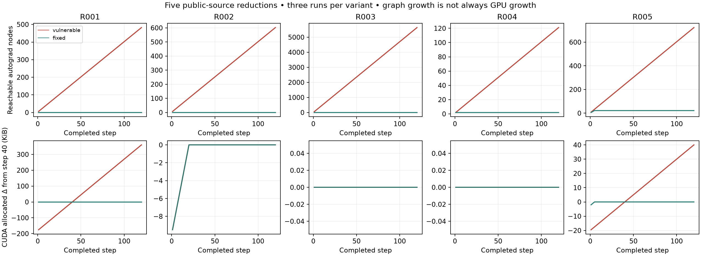

# Phases 1–4: review package and Gate 2

The current Phase 2–4 evaluation covers five public-source reductions; full benchmark scope remains under review. Four remain missed by all four configured baselines; torch-preflight detects the indexed-score control. This is evidence for further review, not approval to build a detector or a claim of publication novelty. Phase 5 has not started and requires confirmation from both the supervisor and peers.

## Phase 1 — exploratory pilot

Seven small paired programs produced five misses and two detected controls. Three repetitions per variant, CUDA measurements, profiler/snapshot evidence and six semantic/oracle tests are preserved. These cases are exploratory; related/synthetic variants do not count as independent public defects. The PDF batch/request experiments were removed at the user's request. See [pilot memo](pilot_memo.md).

## Phase 2 — source-grounded benchmark

The [protocol](phase2_protocol.md) was recorded before benchmark measurements. Each case has a paired correction, workload, provenance, source spans, diff, requirements and runnable collector. All five reproduce accumulating reachable autograd state in three fresh-process CUDA runs (120 steps, seeds 42–44, five separate warm-up steps). Corrections bound it. CPU checks compare 12-step outputs, training gradients and final parameters; the deferred window additionally compares terminal gradients. All checks pass with zero maximum numerical difference in this workload.

| Case and original evidence | Vulnerable nodes, step 40 → 120 | Fixed nodes, step 120 | GPU allocated growth, step 40 → 120 |
|---|---:|---:|---:|
| R001: [indexed scores](https://discuss.pytorch.org/t/memory-leak-when-appending-tensors-to-a-list/25937) | 162 → 482 | 0 | 360 KiB |
| R002: [YOLOX meter](https://github.com/Megvii-BaseDetection/YOLOX/issues/103), [upstream fix](https://github.com/Megvii-BaseDetection/YOLOX/commit/d89453018099062ad0a15d6df2db9a3c65fd3a1a) | 202 → 602 | 0 | 0 |
| R003: [complex BatchNorm statistics](https://discuss.pytorch.org/t/how-does-batchnorm-keeps-track-of-running-mean/40084/16) | 1,879 → 5,639 | 0 | 0 |
| R004: [registered-buffer copy history](https://discuss.pytorch.org/t/copy-operations-get-repeated-in-autograd-computation-graph/122547) | 41 → 121 | 2 | 0 |
| R005: [five-element sliding window](https://discuss.pytorch.org/t/how-to-prevent-this-memory-leak/47581) | 243 → 723 | 22 | 40 KiB |

Values are reproducible across the three runs for graph counts; allocation growth is the median. Fixed allocation growth is zero for every case. R002/R004 demonstrate graph-node retention after ordinary backward, not measured GPU activation accumulation. R003 has growing graph state and some saved scalar storage, but no measured GPU allocation increase. RSS is retained in raw traces; no per-node byte-size or linear CPU-memory claim is inferred from it. R005 intentionally retains five useful graphs, so zero graph nodes is not the correct fixed oracle.

R002/R003 preserve the affected upstream classes; small drivers replace the complete applications. R001/R004/R005 adapt public minimal examples, with shapes and context changes disclosed in metadata. R001 uses indexed diagnostic storage; it is not an extra independent mechanism beyond pilot C000. The R004 correction detaches the destination before copying, retaining the current-step gradient path. R005 uses the author's proposed bounded list plus stacking; detaching every output would break intended gradients and is not the correction used.

These are five reports and **four conservative mechanism families**, grouping the two recursive-statistics reports together. They are below the approximate 8–12 target; the professor explicitly permits fewer strong cases. They are not full original-application runs, five independent human validations, or five previously unknown mechanisms. The screening ledger retains two BOUNDARY candidates and one REJECTED candidate instead of forcing them into the benchmark.

## Phase 3 — paired baseline evaluation

The authoritative [manifest](../results/tools_manifest.csv) remains unchanged for this phase: torch-preflight 0.5.0, TorchFix 0.7.0, CodeQL 2.27.0 / Python queries 1.8.10, and Semgrep 1.180.0. SonarQube is excluded. Default and all documented torch-preflight rules agree. TorchFix uses all rules; generic CodeQL and the frozen Semgrep Python rules are unmodified.

| Baseline | Source-instance detection | Mechanism-family detection | Relevant warnings surviving fixes |
|---|---:|---:|---:|
| torch-preflight, default | 1/5 | 1/4 | 0/5 |
| torch-preflight, all | 1/5 | 1/4 | 0/5 |
| TorchFix, all | 0/5 | 0/4 | 0/5 |
| CodeQL, security-and-quality | 0/5 | 0/4 | 0/5 |
| Semgrep, frozen Python rules | 0/5 | 0/4 | 0/5 |

All scans completed successfully. The relevant R001 warning localizes to indexed storage and disappears on the fix (1/1 relevant finding localized). TG008 seed warnings are unrelated: the seed is set in the external measurement harness. They are retained and adjudicated, not counted as retention detections. Absence of a retention rule in generic linters is contextual evidence, not the novelty argument.

**Representation sensitivity:** initially nesting the R001 score collection directly under the harness context suppressed TG001. A simpler storage alias matching the forum form restores detection. The primary benchmark uses that form; the initial miss is excluded from the substantive gap claim. Static-only checks with observer yields removed leave R002–R005 missed. These checks are robustness evidence, not extra cases.

The overlap review is necessary under the method's WP6. It separates an existing mechanism from an exact known fixture and from unknown overlap. TG001 already tests attached collections and accumulation after backward, so R001/R002 are marked YES_MECHANISM; exact-source prior coverage and R003–R005 overlap remain UNKNOWN after the scoped test/rule/documentation review. Unknown is not independent. Independently-new-case recall is therefore not estimable; known-mechanism instance recall is 1/2 and unknown-overlap instance recall is 0/3 for torch-preflight. These are descriptive selected-case ratios, not population estimates.

## Phase 4 — predefined gap analysis

Only R002–R005 enter the current [gap table](../results/benchmark_gap_analysis.csv). The dimensions were defined in the protocol before scoring: flow scope, sink, aliasing, lifetime, accumulation, cleanup, autograd use and control flow.

R002 and R003 support a recurring theme across separate public reports: persistent statistics retain graph ancestry across method calls and object lifetimes, even after the training backward. R004 extends the lifetime question to a reused registered buffer. R005 shows why bounded container size is insufficient: tensor slicing/catenation keeps ancestry reaching older, no-longer-useful elements. A useful future analysis would need to separate useful bounded current graphs from growing obsolete history, and distinguish graph nodes from saved activations. These observations describe a potential target; no new rule, query or detector has been written.

Gate 2 recommendation: **review the persistent-state gap; hold implementation**. The data justify a focused discussion, but do not establish a new contribution beyond all existing analyses. Supervisor and peer review should confirm the source reductions, intended lifetimes, semantic corrections, conservative mechanism grouping and scope of competitor overlap. A proceed/reformulate/stop decision should be recorded before Phase 5. If broader source reproduction or competitor review changes the conclusion, update the benchmark and rerun the affected pairs before proceeding.

## Artifact and scope notes

- [Ground truth](../results/benchmark_ground_truth.csv), [summary](../results/benchmark_results.csv), [baseline matrix](../results/benchmark_baseline_results.csv), [adjudication](../results/benchmark_finding_adjudication.csv), [metrics](../results/benchmark_metrics.csv), and [candidate screening](../results/benchmark_candidates.csv) are machine-readable.
- Raw per-step traces and environment sidecars are in `results/benchmark_runtime`; commands, execution status, source hashes and raw findings are in `results/benchmark_static`.
- Benchmark measurements include graph introspection overhead and are not performance benchmarks. Private `_saved_*` attributes are version-specific. Saved storage accounting is not total autograd memory accounting.
- The pinned historical complex-layer repository has no license file. Attribution and the limitation are recorded alongside the extracted classes; redistribution permission remains a review item before publishing that source artifact. YOLOX's Apache license is included.
- The historical archive was removed after the user explicitly requested its deletion. Raw diagnostic snapshots remain local and are excluded from Git.
- No commit, GitHub push, detector implementation, held-out evaluation, natural-repository scan or paper claim is included in this phase.
